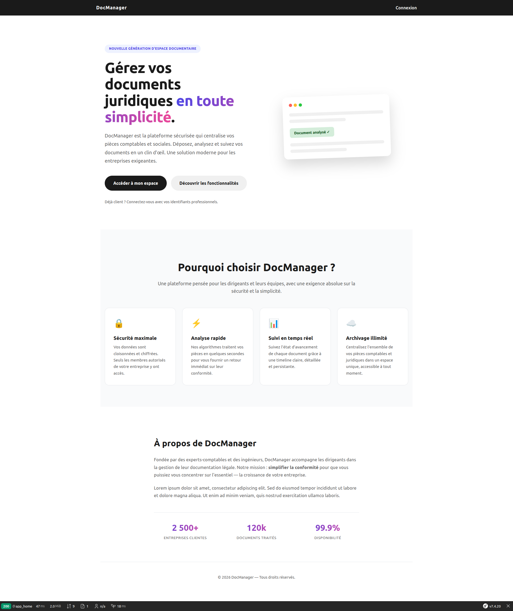
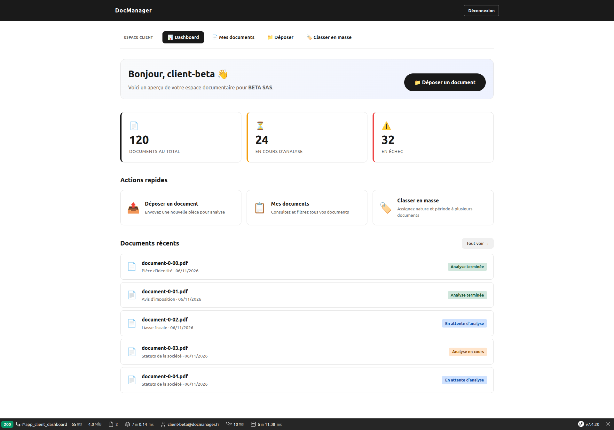
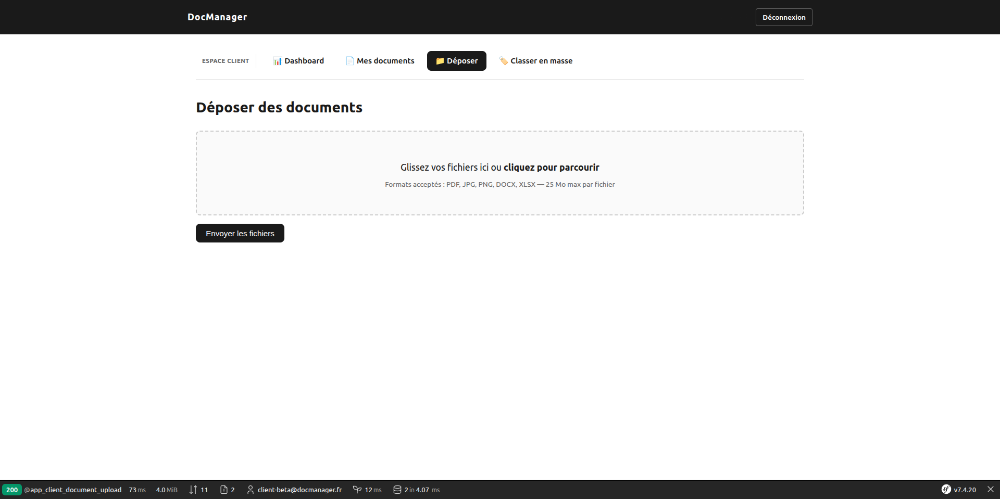
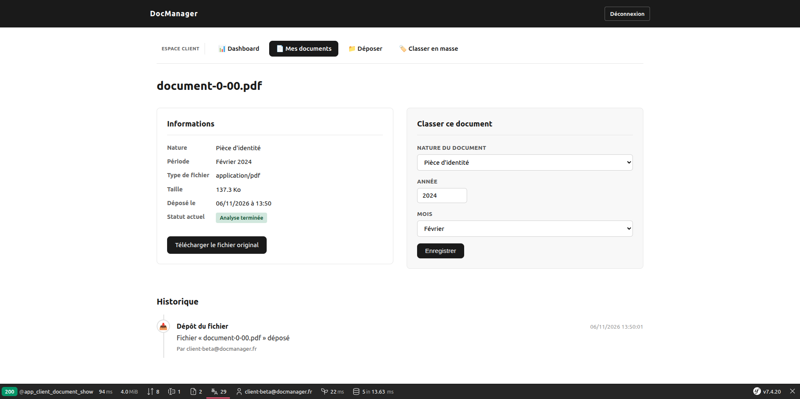
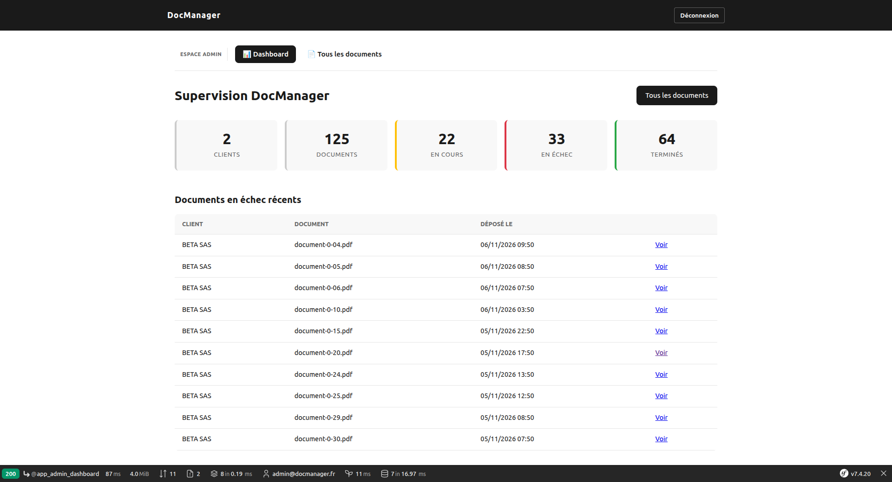
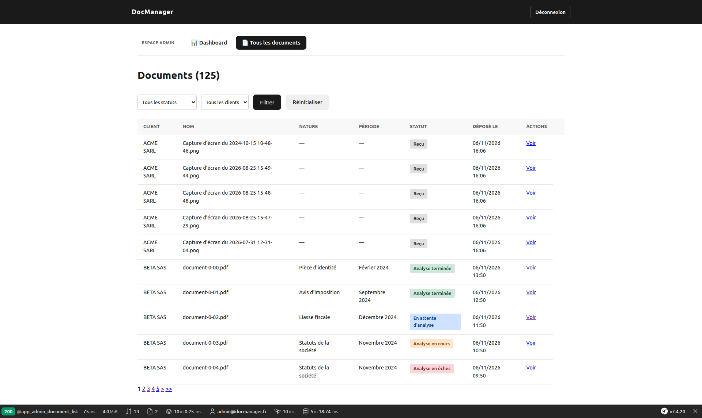
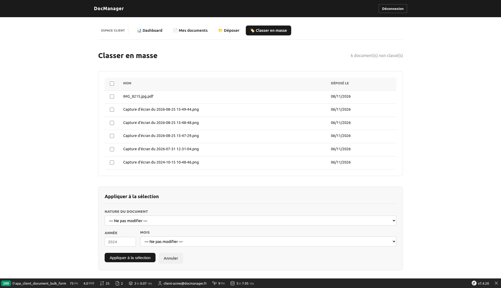

# DocManager — Espace Management de documents Juridiques (MVP)

Espace client + administrateur pour le dépôt, le suivi et l'analyse simulée de pièces comptables, juridiques et sociales.


## Le projet

Ce MVP permet :

- **Au client** : déposer ses pièces, les retrouver, suivre leur analyse
- **À l'admin** : superviser plusieurs dossiers, relancer les analyses en échec

---

## Démarrage rapide

```bash
git clone https://github.com/Hsarah20/Portfolio-document-manager.git
cd Portfolio-document-manager
make init
```

L'application est prête sur **https://localhost:8443**.

---

## Comptes de test

| Rôle        | Email                       | Mot de passe |
|---          |---                          |---           |
| Admin       | `admin@docmanager.fr`       | `admin1234`  |
| Client ACME | `client-acme@docmanager.fr` | `client1234` |
| Client BETA | `client-beta@docmanager.fr` | `client1234` |


## Acces aux services 

| Service	            | URL	                       | Identifiants               |
|---                    |---                           |---                         |
| Application	        | https://localhost:8443	   | _                          |
| Mailpit (emails)	    | http://localhost:8026	       | —                          |
| pgAdmin	            | http://localhost:8081	       | admin@example.com / admin  |
| PostgreSQL	        | localhost:5433	           | docs / docs / db docs      |


## Connexion à la base via pgAdmin 

1. Connectez-vous à http://localhost:8081

2. Clic droit sur Servers → Register → Server…

3. Onglet General : Name = Local()

4. Onglet Connection :

    - Host : database (⚠️ pas localhost)

    - Port : 5432

    - Maintenance database : docs

    - Username : docs

    - Password : docs

    - Save password

5. Save

    *database est le nom du service Docker PostgreSQL. localhost pointerait vers pgAdmin lui-même.

----   

## Tests (PHPUnit)

Le projet dispose de **12 tests automatisés** couvrant la logique métier critique et le cloisonnement des données.

### Lancer les tests

```bash
make test            # tous les tests
make test-unit       # tests unitaires uniquement
make test-functional # tests fonctionnels uniquement
```

----

## Stack

| Composant          | Version                      |
|---                 |---                           |
| PHP                | 8.3                          |
| Symfony            | 7.4 LTS                      |
| PostgreSQL         | 16                           |
| Caddy              | 2.8                          |
| Turbo + Stimulus   | via `symfony/ux-turbo`       |
| AssetMapper        | pas de Node.js, pas de build |
| Messenger          | worker async                 |
| Flysystem          | stockage abstrait (S3-ready) |

---

## Captures d'écran

<table>
  <tr>
    <td></td>
    <td></td>
  </tr>
  <tr>
    <td></td>
    <td></td>
  </tr>
  <tr>
    <td></td>
    <td></td>
  </tr>
  <tr>
    <td colspan="2"></td>
  </tr>
</table>

## Commandes les plus utilisées

```bash
make help            # liste toutes les commandes
make init            # build + up + migrate + fixtures
make logs-worker     # surveiller le worker Messenger
make reset           # repartir de zéro
make db-shell        # psql interactif
```

Voir le [Makefile](Makefile) pour la liste complète.

---

## Architecture en un coup d'œil

```
src/
├── Controller/
│   ├── Admin/             Espace admin
│   └── Client/            Espace client
├── Entity/                Client, User, Upload, Document,
│                          AnalysisAttempt, TimelineEvent
├── Messenger/             3 bus (command/query/event)
├── Security/Voter/        DocumentVoter (cloisonnement strict)
├── Service/Storage/       DocumentStorage (Flysystem)
└── UseCase/
    └── Document/
        ├── Analyze/       Analyse simulée
        ├── Retry/         Relance admin
        └── Upload/        Dépôt client
```

*** Points clés : ****

. 3 bus Messenger : command.bus (écrit), query.bus (lit), event.bus (notifie), avec des middlewares adaptés.

. Worker séparé (doc_worker) pour l'analyse asynchrone : l'utilisateur n'attend pas.

. Voter de sécurité : garantit qu'un client ne voit que ses propres documents, même via URL directe.

. Stockage abstrait (Flysystem) : changer de backend (local → S3) = 4 lignes de YAML.

---

**DocManager ·MVP· Octobre 2026**
